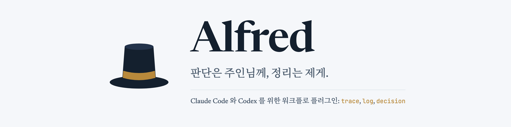
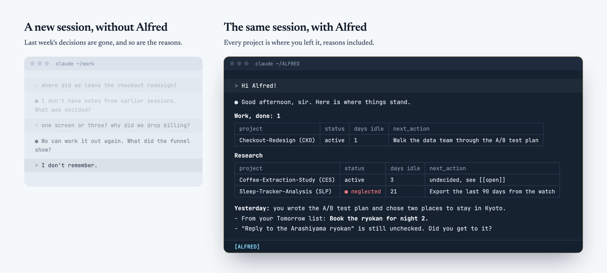
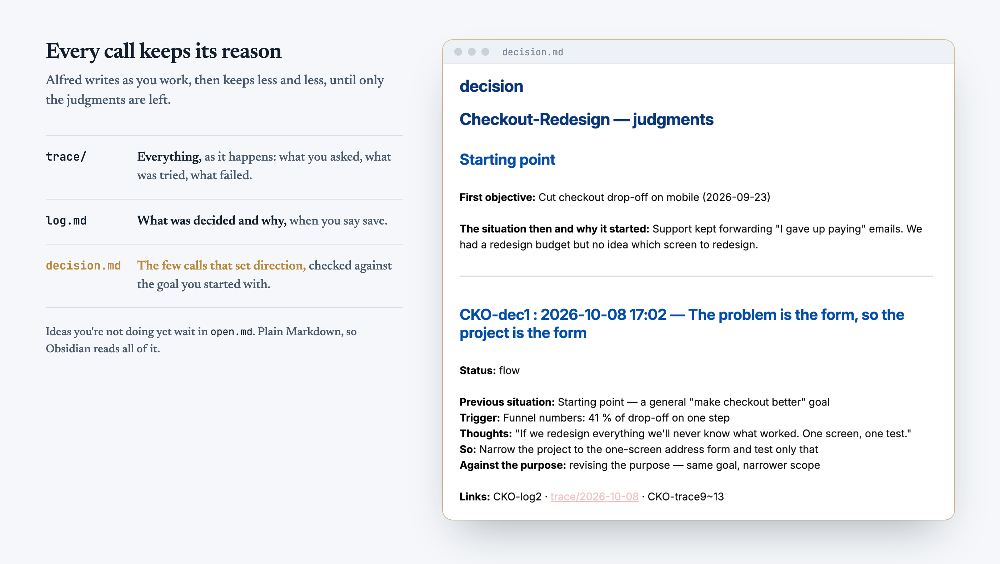

<p align="center"></p>

<p align="center">
  <a href="LICENSE"></a>
  
  
  <a href="https://github.com/ungbin-oh/alfred/stargazers"></a>
</p>

<p align="center">
  <a href="#설치">설치</a> &nbsp;&nbsp; <a href="#새-버전을-받으시려면">새 버전 받기</a> &nbsp;&nbsp; <a href="#제가-드리는-것">제가 드리는 것</a> &nbsp;&nbsp; <a href="#일하는-방식">일하는 방식</a> &nbsp;&nbsp; <a href="#자주-쓰시는-말씀">자주 쓰시는 말씀</a> &nbsp;&nbsp; <a href="#업데이트-히스토리">업데이트 히스토리</a> &nbsp;&nbsp; <a href="README.md">English</a>
</p>

written by Ungbin_Oh · created 2026-09-26 · updated 2026-10-26

프로젝트 여럿을 동시에 굴리고 계신가요? Alfred 가 하나하나 붙잡아 둡니다. 무엇을 했고, 무엇을 정했고, **왜** 그렇게 정했는지.
언제 돌아오셔도 멈춘 그 자리에서 이어 가실 수 있습니다.

- **세션을 열면 모든 프로젝트가 한눈에.** 상태, 마지막 작업, 다음 할 일을 표 하나로
- **모든 결정에 이유가 남습니다.** 나중에 떠올려 적는 게 아니라 일하는 그 순간에
- **결정은 주인님이, 정리는 Alfred 가.** 묻지 않은 제안은 없고, 허락 없이는 아무것도 실행하지 않습니다

## 실제로 쓰는 모습

<p align="center"></p>

<p align="center"></p>

<sub>화면은 지어낸 예시 워크스페이스입니다 (영어 설정).</sub>

## 설치

주인님 경우에 맞는 하나를 고르시고, 그 안의 단계를 위에서 아래로 따라가십시오.
**네모 칸은 전부 치는 것입니다** — 복사해서 터미널에 붙이고 Enter 를 누르십시오.
**칸 사이의 ⚠️ 안내도 단계입니다** (나가기, 다시 열기, 질문에 답하기). 이것을 건너뛰어 막히는 경우가 가장 많습니다.
시작하기 전에 **Claude Code 또는 Codex 가 깔려 있고 로그인이 되어 있어야** 합니다 (Windows 는 Git for Windows 도) — [필요한 것](#필요한-것) 을 보십시오.
Claude Code 와 Codex 를 둘 다 쓰시면, Claude Code 경우를 마치신 뒤 Codex 경우를 이어서 하십시오.

<details>
<summary><strong>macOS, Claude Code</strong></summary>

터미널: **터미널** (zsh)

**Step 1 · Alfred 설치**

```bash
claude plugin marketplace add ungbin-oh/alfred
claude plugin install alfred@alfred
```

**Step 2 · 워크스페이스 폴더를 만들고 거기서 Claude Code 열기**

```bash
mkdir ~/ALFRED
cd ~/ALFRED
claude
```

**Step 3 · 워크스페이스 셋업**

세션 안에서 이것을 치십시오:

```
/alfred-init
```

> [!IMPORTANT]
> ⚠️ **이제 Alfred 가 짧은 질문 두 개를 합니다** — 언어, 그리고 이름과 호칭. **둘 다 답하십시오.** 나머지는 기본값으로 시작하고, 나중에 말만 하면 바꿀 수 있습니다. Alfred 가 끝났다고 말할 때까지가 셋업입니다.

**Step 4 · 같은 폴더에서 Claude Code 다시 열기**

다시 열기 전에는 Alfred 의 어떤 것도 동작하지 않습니다. 나갔다가 Claude Code 를 다시 여십시오:

```
/exit
```

```bash
claude
```

**Step 5 · 가이드 모드 켜기 (처음 며칠은 켜 두시길 권합니다)**

제가 일하는 방식을 짧게 소개하고, 그 뒤로 가끔 사용법 팁을 하나씩 드립니다. 세션 안에서 치십시오:

```
/guide-mode on
```

언제든 `/guide-mode off` 로 끄실 수 있습니다.

✅ **끝.** Alfred 가 켜져 있습니다 — 지금 하고 계신 프로젝트 하나를 말씀해 주시는 것부터 시작하십시오.

</details>

<details>
<summary><strong>macOS, Codex</strong></summary>

터미널: **터미널** (zsh)

**Step 1 · Alfred 설치**

```bash
codex plugin marketplace add ungbin-oh/alfred
codex plugin add alfred-codex@alfred
codex features enable default_mode_request_user_input
```

`features enable` 줄은 한 번만 치시면 됩니다 — 질문 창을 계속 켜 둡니다.

**Step 2 · 워크스페이스 폴더를 만들고 거기서 Codex 열기**

```bash
mkdir ~/ALFRED
cd ~/ALFRED
codex
```

> [!IMPORTANT]
> ⚠️ 이 첫 실행에서 Codex 가 **플러그인 훅을 검토하고 신뢰할지 묻습니다. 신뢰하십시오.** 그 전에는 Alfred 가 로드되지 않습니다.

**Step 3 · 워크스페이스 셋업**

세션 안에서 이것을 치십시오:

```
$alfred-init
```

> [!IMPORTANT]
> ⚠️ **이제 Alfred 가 짧은 질문 두 개를 합니다** — 언어, 그리고 이름과 호칭. **둘 다 답하십시오.** 나머지는 기본값으로 시작하고, 나중에 말만 하면 바꿀 수 있습니다. Alfred 가 끝났다고 말할 때까지가 셋업입니다.

**Step 4 · 같은 폴더에서 Codex 다시 열기**

다시 열기 전에는 Alfred 의 어떤 것도 동작하지 않습니다. 나갔다가 Codex 를 다시 여십시오:

```
/quit
```

```bash
codex
```

**Step 5 · 가이드 모드 켜기 (처음 며칠은 켜 두시길 권합니다)**

제가 일하는 방식을 짧게 소개하고, 그 뒤로 가끔 사용법 팁을 하나씩 드립니다. 세션 안에서 치십시오:

```
$guide-mode on
```

언제든 `$guide-mode off` 로 끄실 수 있습니다.

✅ **끝.** Alfred 가 켜져 있습니다 — 지금 하고 계신 프로젝트 하나를 말씀해 주시는 것부터 시작하십시오.

</details>

<details>
<summary><strong>Windows, Claude Code</strong></summary>

터미널: **PowerShell**

**Step 1 · Alfred 설치**

```powershell
claude plugin marketplace add ungbin-oh/alfred
claude plugin install alfred@alfred
```

**Step 2 · 워크스페이스 폴더를 만들고 거기서 Claude Code 열기**

```powershell
mkdir ~\ALFRED
cd ~\ALFRED
claude
```

**Step 3 · 워크스페이스 셋업**

세션 안에서 이것을 치십시오:

```
/alfred-init
```

> [!IMPORTANT]
> ⚠️ **이제 Alfred 가 짧은 질문 두 개를 합니다** — 언어, 그리고 이름과 호칭. **둘 다 답하십시오.** 나머지는 기본값으로 시작하고, 나중에 말만 하면 바꿀 수 있습니다. Alfred 가 끝났다고 말할 때까지가 셋업입니다.

**Step 4 · 같은 폴더에서 Claude Code 다시 열기**

다시 열기 전에는 Alfred 의 어떤 것도 동작하지 않습니다. 나갔다가 Claude Code 를 다시 여십시오:

```
/exit
```

```powershell
claude
```

**Step 5 · 가이드 모드 켜기 (처음 며칠은 켜 두시길 권합니다)**

제가 일하는 방식을 짧게 소개하고, 그 뒤로 가끔 사용법 팁을 하나씩 드립니다. 세션 안에서 치십시오:

```
/guide-mode on
```

언제든 `/guide-mode off` 로 끄실 수 있습니다.

✅ **끝.** Alfred 가 켜져 있습니다 — 지금 하고 계신 프로젝트 하나를 말씀해 주시는 것부터 시작하십시오.

**막히면**
- "이 시스템에서 스크립트를 실행할 수 없으므로" (npm · codex): 이것을 치고 다시 시도

```powershell
Set-ExecutionPolicy -Scope CurrentUser RemoteSigned
```

</details>

<details>
<summary><strong>Windows, Codex</strong></summary>

터미널: **PowerShell**

**Step 1 · Alfred 설치**

```powershell
codex plugin marketplace add ungbin-oh/alfred
codex plugin add alfred-codex@alfred
codex features enable default_mode_request_user_input
```

`features enable` 줄은 한 번만 치시면 됩니다 — 질문 창을 계속 켜 둡니다.

**Step 2 · 워크스페이스 폴더를 만들고 거기서 Codex 열기**

```powershell
mkdir ~\ALFRED
cd ~\ALFRED
codex
```

> [!IMPORTANT]
> ⚠️ 이 첫 실행에서 Codex 가 **플러그인 훅을 검토하고 신뢰할지 묻습니다. 신뢰하십시오.** 그 전에는 Alfred 가 로드되지 않습니다.

**Step 3 · 워크스페이스 셋업**

세션 안에서 이것을 치십시오:

```
$alfred-init
```

> [!IMPORTANT]
> ⚠️ **이제 Alfred 가 짧은 질문 두 개를 합니다** — 언어, 그리고 이름과 호칭. **둘 다 답하십시오.** 나머지는 기본값으로 시작하고, 나중에 말만 하면 바꿀 수 있습니다. Alfred 가 끝났다고 말할 때까지가 셋업입니다.

**Step 4 · 같은 폴더에서 Codex 다시 열기**

다시 열기 전에는 Alfred 의 어떤 것도 동작하지 않습니다. 나갔다가 Codex 를 다시 여십시오:

```
/quit
```

```powershell
codex
```

**Step 5 · 가이드 모드 켜기 (처음 며칠은 켜 두시길 권합니다)**

제가 일하는 방식을 짧게 소개하고, 그 뒤로 가끔 사용법 팁을 하나씩 드립니다. 세션 안에서 치십시오:

```
$guide-mode on
```

언제든 `$guide-mode off` 로 끄실 수 있습니다.

✅ **끝.** Alfred 가 켜져 있습니다 — 지금 하고 계신 프로젝트 하나를 말씀해 주시는 것부터 시작하십시오.

**막히면**
- "이 시스템에서 스크립트를 실행할 수 없으므로" (npm · codex): 이것을 치고 다시 시도

```powershell
Set-ExecutionPolicy -Scope CurrentUser RemoteSigned
```

</details>

## 새 버전을 받으시려면

**Claude Code**

```
claude plugin marketplace update alfred
claude plugin update alfred@alfred
```

**Codex**

```
codex plugin marketplace upgrade alfred
codex plugin add alfred-codex@alfred
```

워크스페이스의 로그와 설정은 그대로입니다. 업데이트가 주인님 파일을 바꿔야 할 때(새 폴더, 템플릿)는 다음 세션 시작에 말씀드리고, 손대기 전에 여쭙습니다 — 업데이트 내역의 `[Workspace]` 표시입니다.

## 제가 드리는 것

### 기록

| 파일 | 담는 것 |
|---|---|
| `trace/` | 일어난 그대로 전부: 명령, 에러 원문, 가설과 배제 근거. 작업하는 동안 제가 적습니다 |
| `log.md` | 무엇을 정했고 **왜** 그랬는지. 저장하실 때 trace 에서 추려 올립니다. 판단 주체(주인님 / 저)를 항목마다 적습니다 |
| `decision.md` | 프로젝트의 방향을 정한 판단만, 주인님 말씀 그대로, 처음 목표와 비교해서. 제가 여쭈어 받아 적습니다 |
| `open.md` | 하고 싶지만 아직 시작하지 않으실 것. 시작하시거나 접으시면 log 에 남깁니다 |
| `project-logs/Incubator/` | 아직 어느 프로젝트에도 속하지 않는 질문 · 공부 · 잡생각. 아이디어가 여기서 하위 프로젝트로 자랍니다 |
| `daily/` | 날마다의 이야기. "하루를 정리하자" 하시면 trace 로 그날 타임라인을 씁니다 |
| `weekly/` | 한 주에 파일 하나: 이번주 돌아보기와 다음주 계획. 계획은 날마다 daily 의 To do 로 옮겨 드립니다 |
| `Archive/` | 끝났지만 버리지 않을 것을 브리핑 밖으로. 말씀하실 때만 옮깁니다 |

### 세션에서

| | 하는 일 |
|---|---|
| **부팅 브리핑** | 세션을 여시면 폴더마다 프로젝트 표: 상태, 마지막 갱신, 방치 일수, 다음 할 일, 열어둔 것. 14일 넘게 손대지 않은 active 프로젝트는 🔴 neglected 로 표시만 합니다 |
| **질문 창** | 짧게 고르실 것은 객관식 질문 창으로 여쭙니다. 질문마다 답이 하나씩 남습니다. 긴 초안은 채팅으로 확인받습니다 |
| **두 언어** | `/alfred-init` 에서 English 또는 한국어. 규약은 어느 쪽이든 한 벌입니다 |
| `[ALFRED]` 배지 | Alfred 워크스페이스에서만 상태줄에 뜹니다 |
| `/alfred-init` | 워크스페이스를 차립니다. 만들어지는 파일은 전부 주인님 것입니다 |
| `/manual-mode lite\|medium\|full` | 제 손을 묶습니다: 명령과 코드를 주인님께서 직접 치십니다 |
| `/guide-mode on\|off` | 처음 며칠은 짧은 소개, 그 뒤로 가끔 사용법 팁 하나 (Codex 는 `$guide-mode`) |

## 일하는 방식

1. **플러그인이 공통 규약(`alfred-claude/rules/core.md`)의 복사본을 `.alfred/rules.md` 에 두고, 주인님의 `CLAUDE.md` 가 `@.alfred/rules.md` 한 줄로 그것을 불러옵니다.** 플러그인을 업데이트하시면 복사본도 함께 새로워집니다
2. **`/alfred-init` 은 주인님의 파일을 만듭니다** — 설정이 담긴 `CLAUDE.md` 와 폴더 뼈대. 마음대로 고치셔도 됩니다
3. **둘이 어긋나면 주인님의 것이 이깁니다.** 프로젝트 `log.md` 의 `## 형식` > 워크스페이스 `CLAUDE.md` > 공통 규약
4. **`.alfred/workspace` 표식이 없는 폴더에서는 저는 아무것도 하지 않습니다.** 다른 작업에 끼어들지 않습니다
5. 시각은 제가 지어내지 않고 셸의 `date` 로 채웁니다 — 제게는 시계가 없으니까요

```
~/ALFRED/
├── CLAUDE.md              주인님의 설정과 규칙
├── .alfred/workspace      제가 머무는 방이라는 표식 (언어 설정도 여기에)
├── .alfred/rules.md       공통 규약 복사본, 플러그인이 관리합니다 — 고치지 마십시오 (고치시면 덮지 않고 여쭙니다)
├── project-logs/          프로젝트별 log.md · decision.md · open.md · trace/
│   └── Incubator/            질문과 덜 익은 생각, 띄우기 전의 하위 프로젝트
├── project-workspace/     실제 코드 · 산출물
├── daily/                 날짜별 일기
├── weekly/                이번주 돌아보기 + 다음주 계획
└── Archive/               안 쓰지만 버리지 않는 것 — 브리핑은 여기를 보지 않습니다
```

언어를 나중에 바꾸시려면 `.alfred/workspace` 의 `language:` 줄을 `ko` 또는 `en` 으로 고치고 Claude Code 를 다시 여십시오.

## 자주 쓰시는 말씀

| 말씀 | 제가 하는 일 |
|---|---|
| `X 이어서` | 프로젝트 X 로 들어가 지금까지의 흐름을 브리핑 |
| `저장해` | 오늘 한 일과 결정을 요약해 보여 드리고, 허락을 받은 뒤 log.md 에 기록 |
| `하루를 정리하자` | 오늘 trace 로 daily 의 Timeline 작성 |
| `전체 히스토리 봐` | 해당 프로젝트 로그 통독 |

## 물러나게 하시려면

```
claude plugin uninstall alfred@alfred      # Claude Code
codex plugin remove alfred-codex@alfred    # Codex
```

로그와 일기는 그대로 남습니다 — 모두 주인님의 것입니다. 상태줄 배지는 워크스페이스의 `.claude/settings.local.json` 에 있어 폴더와 함께 사라집니다 (예전 방식이라면 `~/.claude/settings.json` 의 `statusLine` 을 지워 주십시오).

## 한국어 규약

제가 따르는 규약의 정본은 영어 한 벌(`alfred-claude/rules/core.md`, `alfred-codex/` 에도 같은 사본)입니다. 주인님께서 읽으실 한국어 번역본은 [`docs/ko/`](docs/ko/) 에 두었습니다.

## 필요한 것

- Claude Code (플러그인 지원 버전), 또는 플러그인을 지원하는 Codex CLI (0.160 에서 확인)
- macOS, Linux 또는 Windows. Windows 에서는 Git for Windows (Git Bash) — 훅이 bash 스크립트입니다

## License

[MIT](LICENSE) © 2026 Ungbin Oh

## 업데이트 히스토리

두 플러그인은 버전 번호 하나를 같이 씁니다. 바뀐 것은 모두 [docs/ko/CHANGELOG.md](docs/ko/CHANGELOG.md) 에 [Claude] · [Codex] · [공통] 을 붙여 적었습니다 (정본은 영어 [CHANGELOG.md](CHANGELOG.md)).

| 버전 | 날짜 | 바뀐 것 |
|---|---|---|
| **0.4.8** | 2026-10-26 | Codex: 업데이트 알림이 다시 로컬 changelog 를 읽습니다 |
| 0.4.7 | 2026-10-25 | guide mode 가 주간 노트를 소개하고, 업데이트 때 weekly 템플릿을 물으면서 쓰는 법도 알려 줍니다 |
| 0.4.6 | 2026-10-25 | 주간 노트(`weekly/`): 이번주 돌아보기와 다음주 계획, 계획은 날마다 To do 로. 브리핑에 Open 열. `docs/` 모양을 정함 |
| 0.4.5 | 2026-10-17 | `[ALFRED]` 상태줄 배지가 다시 기본으로 켜집니다 — 워크스페이스 자체 설정에만, 전역 설정은 건드리지 않습니다 |
| 0.4.4 | 2026-10-17 | 셋업이 짧아짐: `/alfred-init` 이 언어, 이름 · 호칭만 묻고 나머지는 기본값 (나중에 말하면 바꿈) |
| 0.4.3 | 2026-10-10 | Claude Code: 같은 날 연 세션에 `YYYY-MM-DD #1`, `#2` … 로 번호가 붙습니다 (`.alfred/session-count` 로 셉니다) |
| 0.4.2 | 2026-10-10 | 워크스페이스 변경은 제안만: 업데이트 내역에 `[Workspace]` 가 붙은 항목은 업데이트 뒤 하나씩 여쭙습니다 (적용 / 건너뜀). `~/.claude` 의 상태줄 배지 복사본이 오래되면 새 복사본을 제안합니다 |

<details>
<summary>이전 버전</summary>

| 버전 | 날짜 | 바뀐 것 |
|---|---|---|
| 0.4.1 | 2026-10-10 | `.alfred/rules.md` 를 고치셔도 더 이상 덮어쓰지 않습니다: 플러그인이 마지막에 쓴 내용의 해시(`.alfred/rules.sha`)를 두고, 달라진 파일을 알아채면 여쭙니다 — 고친 것을 `CLAUDE.md` 로 옮기거나, 파일을 주인님 것으로 두거나(`.alfred/rules.local`) |
| 0.4.0 | 2026-10-10 | 세션 시작 버전 알림: 새 판의 첫 세션에 "Alfred 가 X → Y 로 바뀌었습니다" 한 번 (마커의 `version:` 줄을 최신으로 맞춤), GitHub 에 더 새 판이 있으면 "업데이트가 있습니다" 와 업데이트 명령 |
| 0.3.5 | 2026-10-06 | 가이드 모드: 소개를 Incubator 추천 줄로 끝냅니다 — 뒤에 질문 창 없음 |
| 0.3.4 | 2026-10-06 | 버그 수정 (Claude): 가이드 모드가 소개 열 줄을 실제로 보여 줍니다. 도구 호출 사이 글이 안 보인다고 가정하던 규칙을 뺐습니다 |
| 0.3.3 | 2026-10-06 | 버그 수정: 긴 글 바로 뒤에도 질문 창을 띄웁니다 (막는 규칙 때문에 Claude 가이드 소개가 한 줄로 줄었음). 짧게 둘 것은 미리보기 칸뿐. `open.md` 를 "아직 시작하지 않을 것을 담는 곳" 으로 고쳐 설명 |
| 0.3.2 | 2026-10-06 | `alfred-init` 이 "지금 다시 시작" 을 맨 끝에 굵게 두고 가이드 모드는 다시 시작한 뒤라고 알립니다. 가이드 모드는 Incubator 에서 시작하기를 권합니다 |
| 0.3.1 | 2026-10-06 | 가이드 모드: `/guide-mode on` 이면 짧은 소개와 가끔 사용법 팁. `alfred-init` 끝에 알려 줍니다 |
| 0.3.0 | 2026-10-06 | 인큐베이터(Incubator): 질문 · 공부 · 잡생각을 두고, 하위 프로젝트가 카테고리로 가기 전에 자라는 곳. `alfred-init` 이 늘 만듭니다 |
| 0.2.3 | 2026-10-06 | 버그 수정: `alfred-init` 의 비서 이름 질문에 선택지가 늘 둘이라, 영어 설정에서도 빠지지 않습니다 |
| 0.2.2 | 2026-10-06 | Claude Code: Alfred 워크스페이스에서 새로 연 세션에 날짜 이름이 붙습니다 |
| 0.2.1 | 2026-10-06 | Codex: `alfred-init` 이 생성 확인과 git 을 채팅으로 묻고(Codex 가 이 둘엔 창을 띄우지 않습니다), 무엇을 입력할지 굵게 적습니다 |
| 0.2.0 | 2026-10-06 | Windows (Codex): 훅을 Git Bash 로 돌립니다. Windows 에서는 Git for Windows 가 필요하고, 질문 창은 셋업 때 한 번 켭니다 |
| 0.1.10 – 0.1.11 | 2026-10-06 | 버그 수정: Windows 에서 워크스페이스 밖 훅 멈춤, Codex 질문 창 |
| 0.1.5 – 0.1.9 | 2026-10-05 | 규약 문장 정리, Codex 플러그인 · 레포 분리, `alfred-init` 수정 |

</details>

**상태: v0.3.5** — macOS · Windows 11 의 Claude Code · Codex 에서 시험했습니다 (0.2.3 까지). 인큐베이터(0.3.0)과 가이드 모드(0.3.1)는 실제 세션에서 아직 써 보지 않았습니다. Linux 는 아직입니다.
